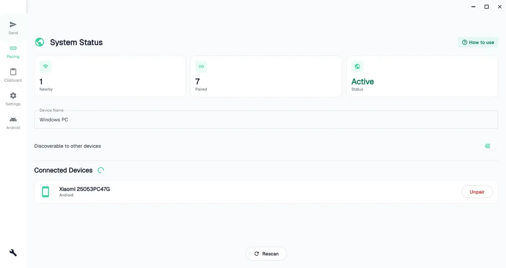
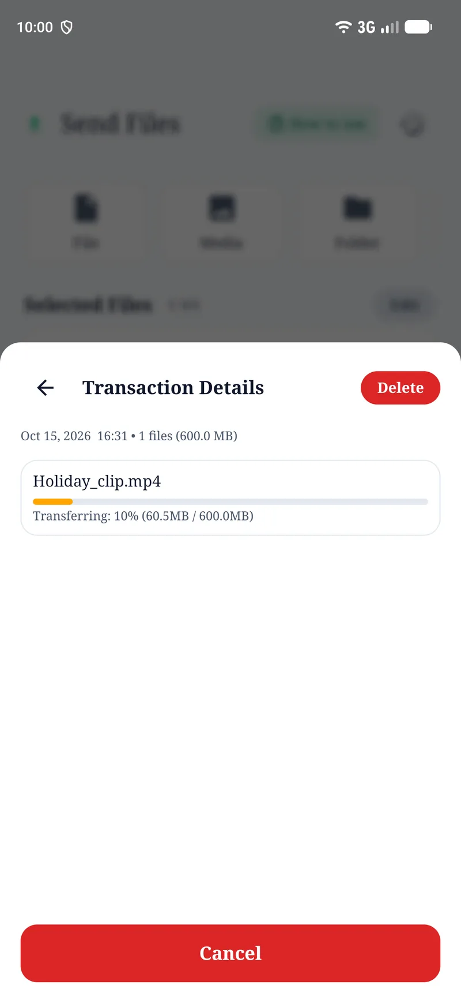
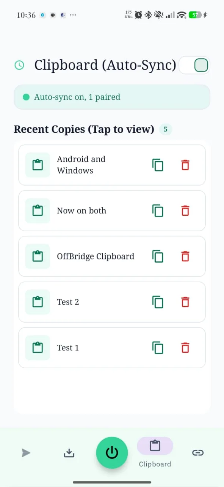
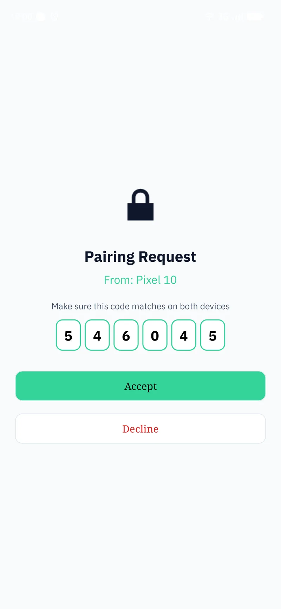
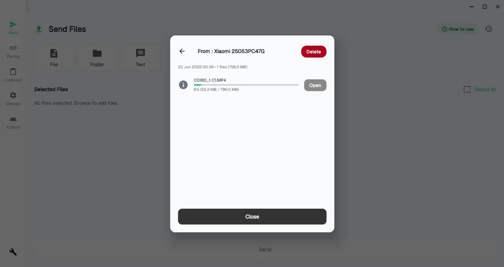
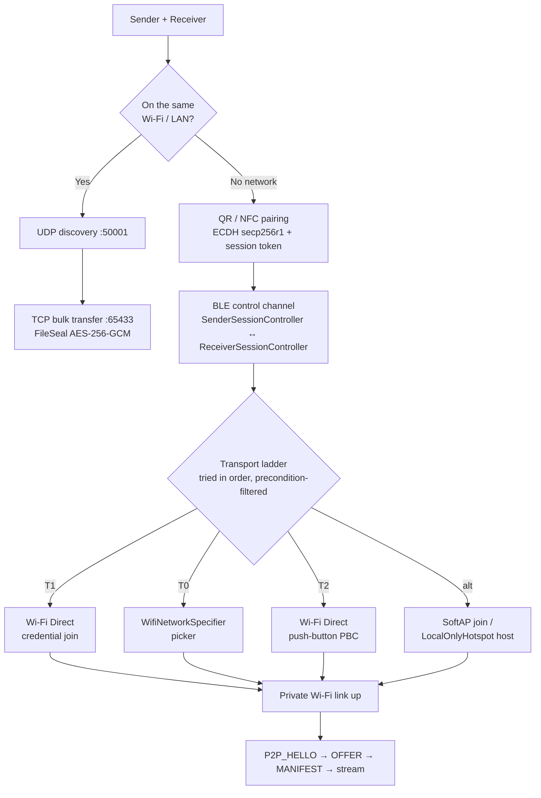

<div align="center">


# OffBridge

**Files and clipboard between Android and Windows, with no router, no internet and no account.**

[](https://play.google.com/store/apps/details?id=com.EntropicSoftwareLab.ClipboardShare)
[](https://github.com/josephting1105123/OffBridge/releases/latest/download/OffBridgeSetup.exe)

[](https://github.com/josephting1105123/OffBridge/releases/latest)
[](https://github.com/josephting1105123/OffBridge/actions/workflows/ci.yml)

[](LICENSE)

[Website](https://entropicsoftwarelabs.com/offbridge/) · [Architecture](ARCHITECTURE.md) · [Changelog](CHANGELOG.md)

<br>

<picture>
  <source media="(prefers-color-scheme: dark)" srcset=".github/assets/windows-main-dark.webp">
  
</picture>
&nbsp;
<picture>
  <source media="(prefers-color-scheme: dark)" srcset=".github/assets/android-transfer-dark.webp">
  
</picture>

</div>

Most cross-device transfer tools need both devices on the same Wi-Fi. OffBridge doesn't. With no router around (a car, a plane, a field, a locked-down office network) it uses Bluetooth LE to set up a direct Wi-Fi link between the two devices and sends your files and clipboard over that. When a shared network is available, it uses that instead. Everything is sealed with AES-256-GCM under a key the two devices agree on when you pair them by QR code.

There are native clients for Android and Windows, and both speak one byte-identical wire protocol.

## Features

| | |
| --- | --- |
| **File transfer** | One file or a whole folder. Transfers resume after a dropped connection. |
| **Clipboard sync** | Copy on one device, paste on the other. |
| **Off-grid mode** | No shared network needed. QR or NFC pairing sets up a direct device-to-device link. |
| **End-to-end encryption** | AES-256-GCM (FileSeal / ClipboardSeal), keys derived by ECDH at pairing, with anti-downgrade trust pinning. |
| **10 languages** | English, 简体中文, 繁體中文, Español, Français, 日本語, Deutsch, Português, Bahasa Indonesia, Русский. |

<details>
<summary><b>More screenshots</b></summary>
<br>
<p align="center">
<picture>
  <source media="(prefers-color-scheme: dark)" srcset=".github/assets/android-clipboard-dark.webp">
  
</picture>
&nbsp;
<picture>
  <source media="(prefers-color-scheme: dark)" srcset=".github/assets/android-sas-verify-dark.webp">
  
</picture>
&nbsp;
<picture>
  <source media="(prefers-color-scheme: dark)" srcset=".github/assets/windows-transfer-dark.webp">
  
</picture>
</p>
</details>

## How it connects

The hard part is connecting two devices when there's no network to connect *over*. A Bluetooth LE control channel starts the session and drives a **transport ladder**: it tries each Wi-Fi tier in turn, and sender and receiver move down the ladder together (`TRY_TRANSPORT → TRANSPORT_RESULT`) so they never end up on different rungs. Once a link is up, the bulk transfer is plain TCP.



The full wire format, crypto and threat model are in **[ARCHITECTURE.md](ARCHITECTURE.md)**.

## Security

When you pair two devices they agree on a shared AES-256 key by ECDH (secp256r1), and you confirm it by checking that a short code matches on both screens. Every file chunk and clipboard payload after that is sealed with AES-256-GCM, with the record's position bound into the AEAD so bytes can't be reordered, replayed or spliced.

Capabilities are advertised over unauthenticated UDP discovery, so a peer that has once used the authenticated channel is *pinned*: if it later stops offering it, the transfer fails closed instead of quietly falling back to something weaker. What an attacker on the air can and can't do is written out in the [threat model](ARCHITECTURE.md#threat-model).

## Build from source

**Android** (`:app`, needs Android 10 or later to run)

```bash
./gradlew :app:assembleDebug
```

**Windows** (`:window-ver`, Compose Multiplatform on JVM 17, sources in `Window Ver/`)

```bash
./gradlew :window-ver:run    # run the desktop client
./gradlew :window-ver:test   # unit tests
```

CI builds both clients and runs the crypto and wire-format golden-vector tests on every push.

## Project layout

| Path | What's there |
| --- | --- |
| `app/` | Android client: Jetpack Compose UI, transport ladder, foreground services |
| `Window Ver/` | Windows client: Compose Multiplatform desktop app |
| `app/.../transport/`, `Window Ver/.../network/` | The shared wire protocol and crypto, kept byte-identical by golden-vector tests |
| `ARCHITECTURE.md` | Wire format, crypto, threat model |

## License

Apache 2.0. See [LICENSE](LICENSE) and [NOTICE](NOTICE).
