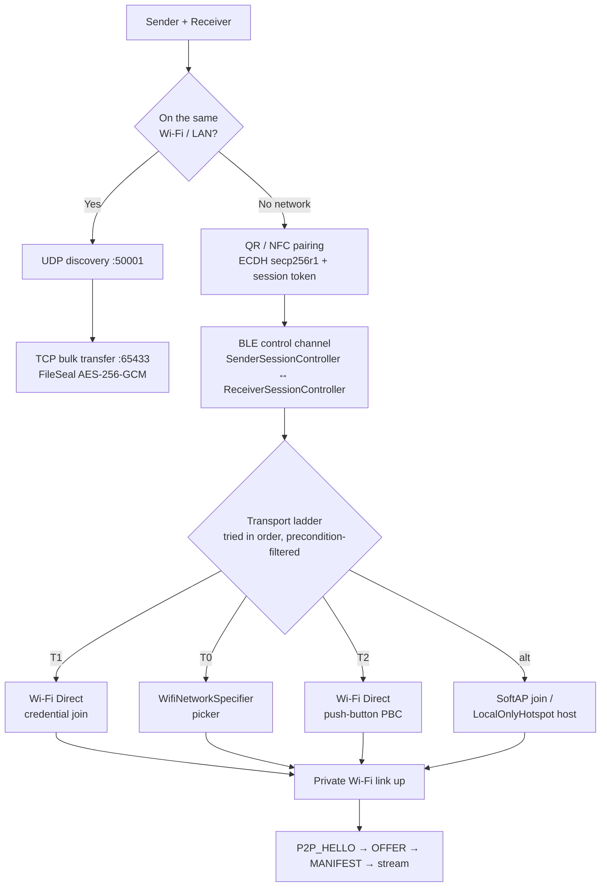

<!--
  Badge row: the Platforms / Version / Kotlin / License badges below are static and render as-is.
  The CI and release-download badges need your GitHub repo slug — replace OWNER/REPO once the repo is
  public, or delete those two lines. The licence badge matches the LICENSE file at the repo root (Apache-2.0).
-->

# OffBridge

**Send files and sync your clipboard between Android and Windows — with no router, no internet, and no account.** End-to-end encrypted, open source.


<!-- [](https://github.com/OWNER/REPO/actions/workflows/ci.yml) -->
<!--  -->

Most cross-device transfer tools need you to be on the same Wi-Fi network. OffBridge doesn't. When there's no router — a car, a plane, a field, a locked-down corporate network — it bootstraps a direct link between the two devices over a Bluetooth control channel and Wi-Fi Direct, and moves your files and clipboard across it. When a network *is* available, it uses it. Everything is sealed with AES-256-GCM under a key the two devices agree on when you pair them by QR code.

> Native clients for **both** Android and Windows, speaking one byte-identical wire protocol.

## What it does

- **File transfer** — one file or a whole folder, resumable across a dropped connection.
- **Clipboard sync** — copy on one device, paste on the other.
- **Off-grid mode** — no shared network required. QR / NFC pairing bootstraps a direct device-to-device link.
- **End-to-end encryption** — AES-256-GCM (FileSeal / ClipboardSeal), keys derived via ECDH at pairing, with anti-downgrade trust pinning.
- **10 languages** — English, 简体中文, 繁體中文, Español, Français, 日本語, Deutsch, Português, Bahasa Indonesia, Русский.

## Architecture

The interesting part is how two devices connect when there is no network to connect *over*. A Bluetooth LE control channel bootstraps the session and drives a **transport ladder**: it tries each Wi-Fi-bearing tier in turn, and the sender and receiver advance together (`TRY_TRANSPORT → TRANSPORT_RESULT`) so they never end up on different rungs. Once a link is up, the bulk transfer is plain TCP.



Full wire format, crypto, and threat model: **[ARCHITECTURE.md](ARCHITECTURE.md)**.

## Security in one paragraph

Two devices establish a shared AES-256 key by ECDH (secp256r1) when you pair them, confirmed by a short PIN/SAS you check on both screens. Every file chunk and clipboard payload after that is sealed with AES-256-GCM, with the record's position bound into the AEAD so bytes can't be reordered, replayed, or spliced. Capability advertisement rides unauthenticated UDP discovery, so a peer that has once negotiated the authenticated channel is *pinned* — if it later stops offering it, the transfer fails closed instead of silently dropping to a weaker path. What an on-air attacker can and can't do is written out plainly in [ARCHITECTURE.md](ARCHITECTURE.md#threat-model); there is no "military-grade" hand-waving.

## Build

**Android** (`:app`)
```bash
JAVA_HOME="<path-to-jbr>" ./gradlew :app:assembleDebug
```

**Windows** (`:window-ver`, Compose Multiplatform, JVM 17)
```bash
./gradlew :window-ver:run          # run the desktop client
./gradlew :window-ver:test         # unit tests
```

CI builds both clients and runs the crypto/wire golden-vector tests on every push.

## Project layout

| Path | What's there |
|------|--------------|
| `app/` | Android client — Jetpack Compose UI, transport ladder, foreground services |
| `Window Ver/` | Windows client — Compose Multiplatform desktop app |
| `app/.../transport/`, `Window Ver/.../network/` | The shared wire protocol + crypto, kept byte-identical by golden-vector tests |
| `ARCHITECTURE.md` | Wire format, crypto, threat model |

## Status

Android 3.7.5 · Windows 3.7.9. Both clients are functional and distributed via GitHub. The off-grid transport ladder, resumable transfers, encryption, and 10-language localization are in place. See [CHANGELOG.md](CHANGELOG.md).
